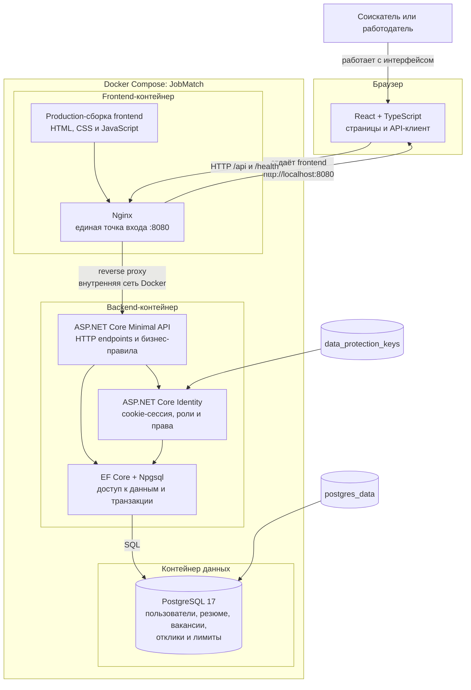
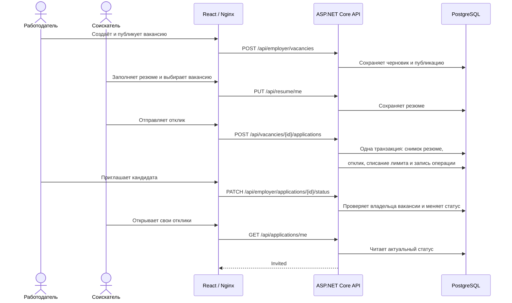

# Архитектура JobMatch

**Версия:** 1.0 от 22 октября 2026 года.
**Статус:** фактическая архитектура демонстрационного MVP в ветке `main`.

## Общая схема

На компьютере пользователя опубликован только порт frontend-контейнера `127.0.0.1:8080`. Браузер получает React-приложение от Nginx и отправляет запросы на тот же адрес. Nginx перенаправляет `/api/*` и `/health` к backend во внутренней сети Docker. Backend напрямую из браузера не публикуется, а PostgreSQL доступен только backend.

## Ответственность компонентов

| Компонент | Ответственность |
|---|---|
| React + TypeScript | Страницы гостя, соискателя и работодателя; формы; навигация; состояния загрузки и ошибок; вызовы API. |
| Nginx | Раздача production-сборки frontend, поддержка маршрутов SPA и проксирование запросов в backend. |
| ASP.NET Core API | Авторизация, проверка ролей и владения ресурсами, сценарии резюме, компании, вакансий и откликов, лимиты и переходы статусов. |
| ASP.NET Core Identity | Пользователи, проверка паролей и cookie-сессии. Пользователь выбирает одну роль: `Candidate` или `Employer`. |
| EF Core + Npgsql | Отображение доменных сущностей в PostgreSQL, миграции, ограничения и атомарные операции со списанием отклика. |
| PostgreSQL | Постоянное хранение данных MVP. Схема подробнее показана в [ERD](erd.md). |
| Docker Compose | Сборка и согласованный запуск трёх контейнеров, зависимости запуска и проверки готовности. |

## Прохождение основного сценария

## Размещение исходников

- `jobmatch-frontend` — React-приложение, Nginx и frontend-тесты.
- `jobmatch-backend` — API, доменная модель, EF Core, миграции, seed, backend-тесты и `compose.yaml`.
- `jobmatch-docs` — требования, архитектура, ERD, OpenAPI, планирование и материалы демонстрации. Этот репозиторий не требуется для работы запущенного приложения.

Архитектура представляет собой один клиент, один модульный backend и одну базу данных. Микросервисы, отдельная очередь сообщений и внешний сервис авторизации в MVP не используются.
