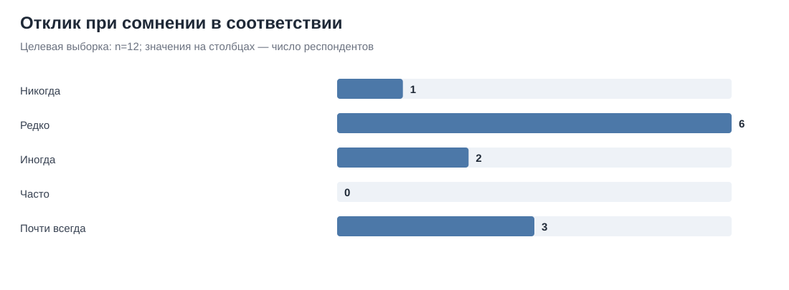
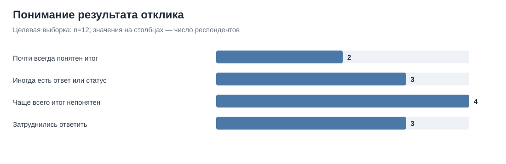
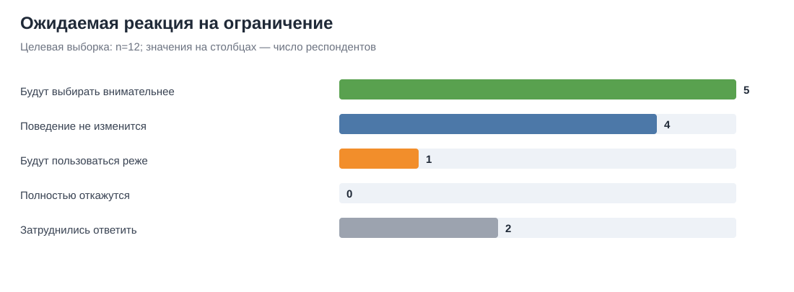
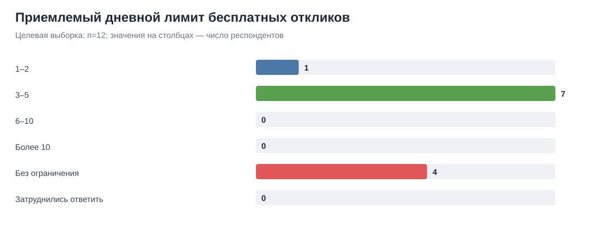
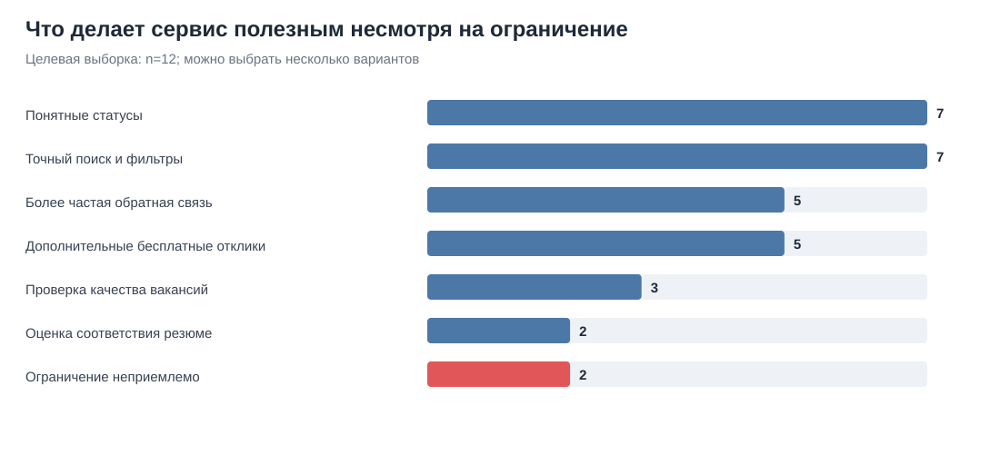
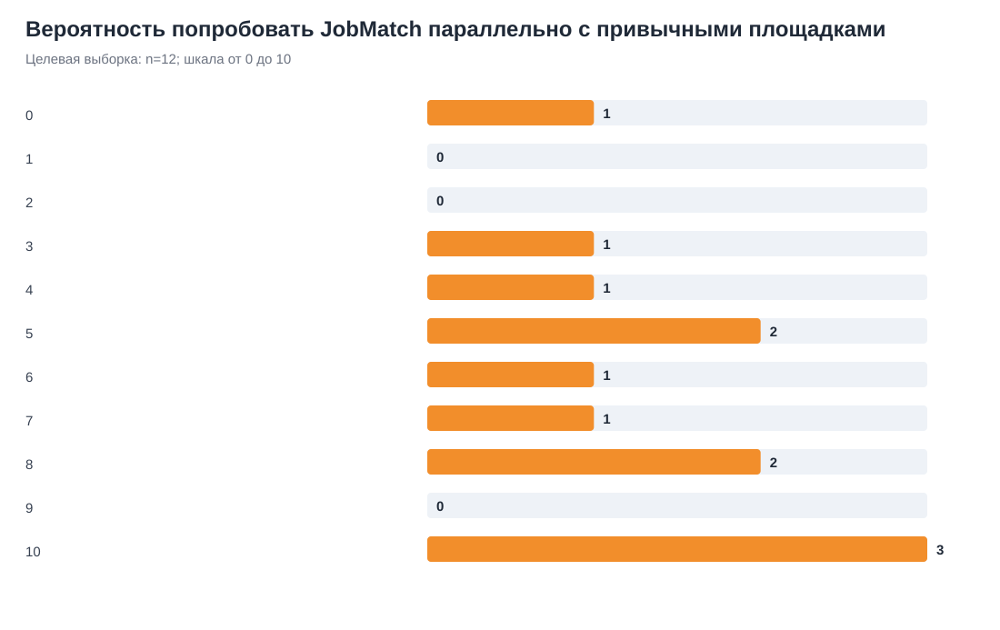

# JobMatch — результаты опроса соискателей

**Ответственный за сбор и обработку:** Матвей.

**Период ответов:** 9–16 октября 2026 года.

**Дата обработки:** 21 октября 2026 года.

**Статус:** предварительный результат только по соискателям; сбор ответов работодателей продолжается.

## Краткий вывод

Опрос даёт смешанный, но полезный сигнал. Механика ограничения не получила однозначной поддержки: 41,7% целевых респондентов ожидают, что будут внимательнее выбирать вакансии, что ниже предварительного порога 50%. При этом 58,3% считают приемлемым лимит `3–5` бесплатных откликов в день, а 50% поставили готовности попробовать сервис оценку от 7 до 10.

Главный риск заметен уже на небольшой выборке: 33,3% считают, что ограничений быть не должно. Компенсировать ограничение могут понятные статусы откликов и более точный поиск — каждый вариант выбрали по 58,3% участников. Пять откликов в день можно оставить параметром будущего пилота, но опрос не доказывает, что это оптимальный лимит или что он действительно улучшит качество откликов.

## Выборка и обработка

В выгрузке было 18 отправленных форм. В анализ вошли только респонденты, которые добровольно согласились участвовать и искали работу или стажировку в течение последних 12 месяцев.

| Этап | Количество |
|---|---:|
| Получено отправленных форм | 18 |
| Согласились участвовать | 16 |
| Отказались от участия | 2 |
| Не относятся к целевой группе | 4 |
| Неполные целевые ответы | 0 |
| Точные дубли среди целевых ответов | 0 |
| Включено в анализ | **12** |

Из четырёх исключённых по профилю трое искали работу раньше, но не в последние 12 месяцев, один никогда не искал работу. Форма не фиксировала источник перехода, поэтому фактическое распределение участников по каналам привлечения неизвестно.

Выборка меньше планового ориентира `20–30` целевых ответов и набрана удобным способом. Поэтому результаты являются разведочными и не представляют всех соискателей российского рынка труда.

## Профиль и поведение соискателей

- 50% (6 из 12) активно ищут работу сейчас; остальные 50% искали её в течение последних 12 месяцев.
- 41,7% (5 из 12) обычно отправляют более 20 откликов за неделю активного поиска. Ещё трое затруднились назвать количество.
- 50% (6 из 12) всегда полностью читают описание и основные требования. Ещё 41,7% делают это иногда, 8,3% — редко.
- 41,7% (5 из 12) откликаются при сомнении в соответствии хотя бы иногда. Это минимально превышает предварительный порог H2 в 40%.
- 33,3% (4 из 12) чаще всего не понимают, был ли отклик рассмотрен. Только 16,7% (2 из 12) почти всегда видят понятный итоговый статус.

### Причины отклика при неполном соответствии

Вопрос С5 был показан 11 участникам; один человек ответил, что никогда не откликается при сомнении в соответствии.

| Причина | Результат |
|---|---:|
| Надежда, что работодатель всё равно рассмотрит резюме | 63,6% (7 из 11) |
| Массовые отклики ради повышения шанса ответа | 54,5% (6 из 11) |
| Быстрая отправка отклика | 45,5% (5 из 11) |
| Подходят зарплата, компания или формат работы | 45,5% (5 из 11) |
| Требования выглядят завышенными | 27,3% (3 из 11) |
| Не до конца понятны обязанности или требования | 9,1% (1 из 11) |

Два свободных варианта не публикуются дословно. Они не образуют устойчивой содержательной темы.

## Реакция на концепцию JobMatch

| Показатель | Результат |
|---|---:|
| Будут внимательнее сравнивать вакансии | 41,7% (5 из 12) |
| Поведение почти не изменится | 33,3% (4 из 12) |
| Будут реже пользоваться сервисом | 8,3% (1 из 12) |
| Полностью откажутся | 0% (0 из 12) |
| Затруднились оценить влияние | 16,7% (2 из 12) |

### Приемлемый лимит

| Вариант | Результат |
|---|---:|
| `1–2` отклика в день | 8,3% (1 из 12) |
| `3–5` откликов в день | 58,3% (7 из 12) |
| Ограничения быть не должно | 33,3% (4 из 12) |
| Остальные варианты | 0% (0 из 12) |

Результат поддерживает использование значения `5` как рабочего параметра пилота, но не подтверждает его как оптимальное продуктовое решение. Треть целевой выборки отвергает сам принцип ограничения.

### Что должно компенсировать ограничение

83,3% (10 из 12) выбрали хотя бы одно полезное преимущество помимо варианта «ограничение неприемлемо».

| Возможность | Результат |
|---|---:|
| Понятные статусы каждого отклика | 58,3% (7 из 12) |
| Более точный поиск и фильтры | 58,3% (7 из 12) |
| Более частая обратная связь работодателя | 41,7% (5 из 12) |
| Дополнительные бесплатные отклики | 41,7% (5 из 12) |
| Проверка качества и актуальности вакансий | 25% (3 из 12) |
| Объяснение соответствия резюме вакансии | 16,7% (2 из 12) |
| Ничего, ограничение неприемлемо | 16,7% (2 из 12) |

Один ответ одновременно содержит полезные преимущества и вариант «ограничение неприемлемо». Он сохранён в распределении, но отмечен как внутренне противоречивый.

### Готовность попробовать сервис

- медиана оценки — `6,5` из 10;
- средняя оценка — `6,33`;
- 50% (6 из 12) поставили от 7 до 10;
- 25% (3 из 12) поставили от 0 до 4.

Восемь респондентов оставили необязательное пояснение. Два комментария выражают интерес, два содержат содержательные возражения: недостаточную конкурентоспособность относительно крупных площадок и сомнение в лимите при автоматической фильтрации резюме. Четыре пояснения слишком краткие или шуточные и не использовались как доказательства.

## Проверка гипотез по данным соискателей

| Гипотеза | Предварительный сигнал | Результат | Вывод по опросу соискателей |
|---|---|---|---|
| H1. Нерелевантные отклики создают работодателям нагрузку | Данные работодателей | Сбор продолжается | Не оценивалась |
| H2. Часть соискателей откликается при слабом соответствии | Не менее 40% делают это хотя бы иногда | 41,7% (5 из 12) | Поддержана предварительно, с минимальным превышением порога |
| H3. Ограничение повысит осознанность выбора | Не менее 50% ожидают более внимательного выбора | 41,7% (5 из 12) | Не поддержана по текущей выборке |
| H4. Ограничению нужна встречная ценность | Большинство выбирает хотя бы одно преимущество | 83,3% (10 из 12) | Поддержана предварительно |
| H5. Механика приемлема хотя бы для пилота | Есть заинтересованные кандидаты и работодатели без общего критического возражения | 50% оценили вероятность пробы в 7–10; 33,3% отвергают любой лимит; данные работодателей ещё собираются | По соискателям сигнал смешанный; общий вывод пока невозможен |

## Рекомендации для MVP и следующей проверки

1. Не выдавать ограничение `5 откликов в день` за доказанный оптимум. Использовать его как проверяемый параметр пилота.
2. Сохранить в MVP видимый остаток откликов и понятные статусы заявок. Эти функции напрямую отвечают на частые запросы выборки.
3. Не рассчитывать на один лимит как на способ изменить поведение: порог H3 не достигнут.
4. В следующем эксперименте сравнить группу без лимита и группу с лимитом по доле релевантных откликов, приглашениям и уходу пользователей.
5. Продолжить сбор работодателей отдельно. До получения их результатов не делать общий вывод по H1 и H5.
6. Если есть время, добрать целевую выборку соискателей до запланированных 20–30 ответов. Текущие 12 ответов достаточны только для разведочного вывода.

## Ограничения и конфиденциальность

- выборка мала и неслучайна;
- форма не собирала профессию, опыт и регион, поэтому сегменты сравнить нельзя;
- опрос измеряет заявленные намерения, а не фактическое поведение;
- точный канал привлечения каждого участника неизвестен;
- часть необязательных текстов неинформативна;
- причинный эффект ограничения можно проверить только поведенческим экспериментом.

Исходная построчная выгрузка не публикуется в открытом репозитории. В ней нет ФИО и email, но сочетание времени и свободных ответов может облегчить идентификацию участника. Для проверки расчётов опубликованы [обезличенная построчная выгрузка без времени и свободного текста](results/candidate-survey-anonymized.csv), [агрегированная таблица](results/candidate-survey-aggregates.csv), [машиночитаемая сводка](results/candidate-survey-summary.json) и [скрипт обработки](scripts/analyze_candidate_survey.py).
